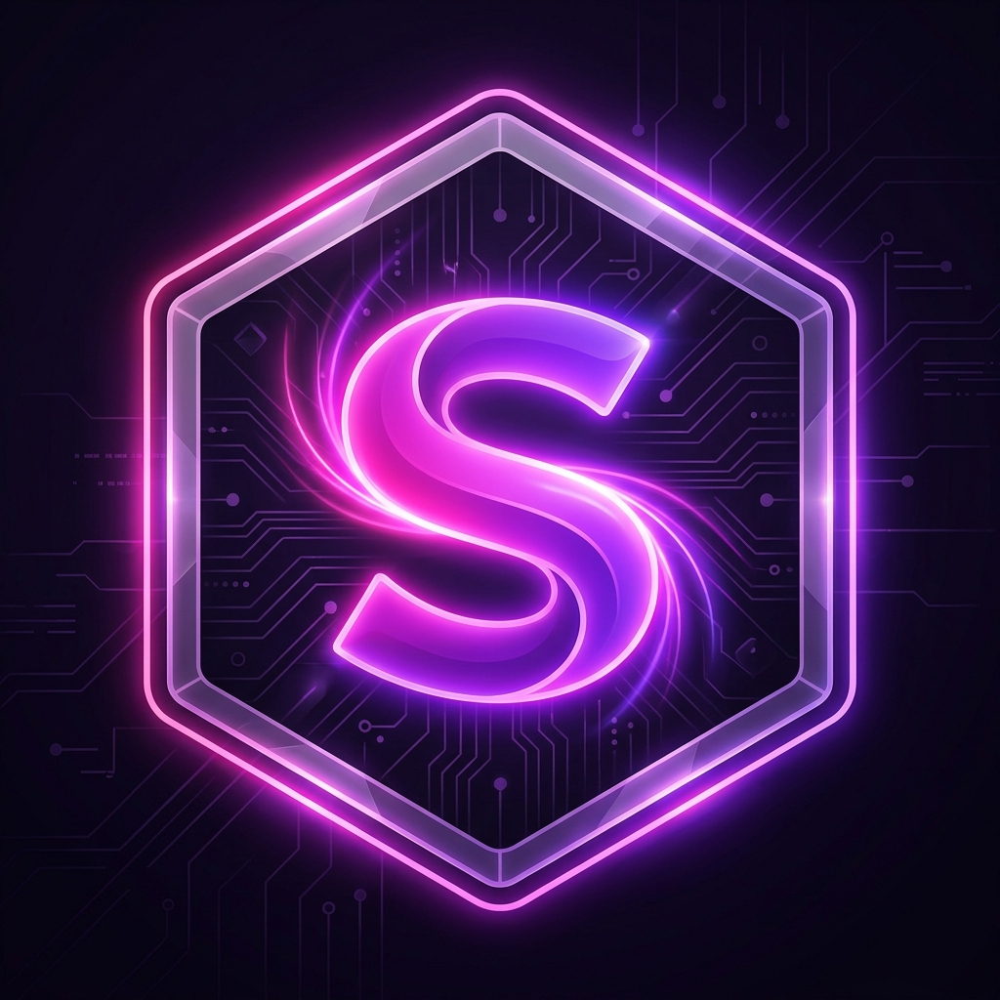

<div align="center">
  
  <h1>🌸 SENJU AI Assistant</h1>
  <p><strong>Smart. Expressive. eXpert. Your-companion.</strong></p>
  <p>A highly advanced, immersive 3D desktop AI assistant built with Electron, featuring multi-LLM support, voice interactions, and a futuristic visual interface.</p>
</div>

---

## ✨ Features

### 🧠 AI Brain (NVIDIA Nemotron)
- Runs entirely on **NVIDIA's API** — paste your key from [build.nvidia.com](https://build.nvidia.com/settings/api-keys) (`nvapi-…`) under *Settings → AI Engine*.
- **Model chain with auto-fallback**: `nemotron-3-super-120b-a12b` → `nemotron-3.5-lightning-30b-a3b` → `nemotron-nano-3-30b-a3b` → `llama-3.1-nemotron-ultra-253b-v1`. Rate-limited models are skipped for a minute; pick the first choice in Settings. Thinking mode is switched off so spoken replies stay quick.
- **Native tool calling** (`modules/tools.js`): reminders, timetable, open apps, volume, YouTube, WhatsApp, shutdown (60s, cancellable), plus every tool from your MCP servers.
- **Lookups without extra keys**: facts via DuckDuckGo Instant Answers + Wikipedia, weather via Open-Meteo. For live news/scores, add a search MCP server (see below).
- **Long-term memory**: SENJU saves lasting facts about you (`remember_fact` / `forget_fact`) and uses them in every chat.

### 🔌 MCP servers
- SENJU is an MCP client: add servers under *Settings → MCP Servers* (same `mcpServers` format as Claude Desktop) and the brain can use their tools alongside its own.
- Local servers use `command`/`args`/`env`; remote ones use `url` (+ optional `headers`, `"type": "sse"` for older servers). Add `"disabled": true` to switch one off.
- Want live web search? Add a search server, e.g. Brave Search (free API key at brave.com/search/api):
  `"brave": { "command": "npx", "args": ["-y", "@brave/brave-search-mcp-server"], "env": { "BRAVE_API_KEY": "…" } }`
- Config lives in `mcp.json` in SENJU's data folder (`~/.config/dvsc-assistant/` on Linux, `%APPDATA%\dvsc-assistant\` on Windows).

```json
{
  "mcpServers": {
    "filesystem": { "command": "npx", "args": ["-y", "@modelcontextprotocol/server-filesystem", "/home/vivek/Documents"] },
    "github": { "command": "npx", "args": ["-y", "@modelcontextprotocol/server-github"], "env": { "GITHUB_PERSONAL_ACCESS_TOKEN": "ghp_…" } }
  }
}
```

### 🌌 Immersive UI (SENJU Mode)
- **3D Solar System Visualizer**: A fully interactive 3D canvas rendering a solar system where planets represent different file categories and directories.
- **Dynamic Mood Cycling**: UI colors shift dynamically (Sakura, Ocean, Aurora, Lava, Neon, etc.) to keep the interface feeling alive.
- **Futuristic HUD**: Iron Man / Cyberpunk-inspired glassmorphism design with glowing neon borders, real-time typing indicators, and boot sequences.

### 🎙️ Voice & Audio Integration
- **Wake Word Detection**: Powered by Picovoice Porcupine (e.g., saying "Wake up SENJU").
- **Voice Activity Detection (VAD)**: Listens for commands automatically when the mic is active.
- **Speech-to-Text**: NVIDIA Nemotron 3 Nano Omni transcribes your voice (Hinglish/Hindi/English, written in Roman script).
- **Text-to-Speech (TTS)**: Microsoft Edge Neural TTS (`hi-IN-SwaraNeural`) for a natural, expressive voice.

### 🔌 Advanced Integrations
- **WhatsApp Web Integration**: Scan a QR code to link your WhatsApp and have SENJU read or send messages (`whatsapp-web.js`).
- **YouTube Search**: Directly search for music and videos via voice commands.
- **System Control**: Adjust system volume (`loudness`) directly from the AI — Windows and Linux.
- **Reminders & Timetable**: Built-in `electron-store` scheduling system for daily tasks and alarms.

---

## 🛠️ Tech Stack

**Frontend (Renderer)**
- **HTML5 Canvas API** (for the 3D Fibonacci sphere and Solar System math)
- **Vanilla JavaScript & CSS3** (No heavy frameworks, raw performance)
- **Google Fonts**: Orbitron (Sci-Fi headers) & Inter (Clean body text)

**Backend (Main Process)**
- **Electron.js** (Desktop framework)
- **Node.js** (Filesystem, OS level integrations)

**Key NPM Packages**
- `@google/generative-ai` - Gemini AI integration
- `node-llama-cpp` - Local LLM execution
- `whatsapp-web.js` - WhatsApp automation
- `edge-tts-universal` - Neural voice generation
- `@picovoice/porcupine-node` & `pvrecorder-node` - Wake word & audio capture
- `electron-store` - Persistent local storage
- `loudness` - System volume control
- `yt-search` & `youtube-sr` - YouTube integrations

---

## 🚀 Getting Started

### Prerequisites
- Node.js (v18+)
- An NVIDIA API key from [build.nvidia.com](https://build.nvidia.com/settings/api-keys).

### Installation

1. **Clone the repository**
   ```bash
   git clone https://github.com/vivek1234-byte/SENJU_AI.git
   cd SENJU_AI
   ```

2. **Install dependencies**
   ```bash
   npm install
   ```

3. **Configure API Keys**
   Add your API keys to the system settings or `.env` equivalent configuration.

4. **Run the App**
   ```bash
   npm start
   ```

### 🐧 Linux

SENJU runs on Linux too (tested on Fedora + KDE Plasma). One-time setup:

```bash
./install-linux.sh
```

This makes `node_modules` Linux-ready (also fixes a folder copied over from Windows), installs the SENJU icon and app-menu entry, puts a shortcut on the Desktop, and pins SENJU to your dock / taskbar (KDE Plasma or GNOME). After that, launch it from the dock or with `./senju.sh`.

On Linux, volume control uses `amixer` (alsa-utils), shutdown uses `shutdown -h +1`, and apps/links open through `xdg-open` or the matching Linux app (Dolphin, Konsole, KCalc, …).

## 🎨 File Structure

```text
SENJU_AI/
├── assets/             # Icons, logos, and background images
├── modules/            # Backend logic (NVIDIA brain, MCP client, TTS, WhatsApp, Reminders)
├── styles/             # CSS styling (main.css, jarvis.css for 3D HUD)
├── index.html          # Main UI layout and boot sequence
├── main.js             # Electron main process & IPC handlers
├── preload.js          # Electron preload script (Security bridge)
├── renderer.js         # Core frontend logic, 3D math, and UI state
└── package.json        # Dependencies & scripts
```

<div align="center">
  <p>Built for the future. 🚀</p>
</div>
